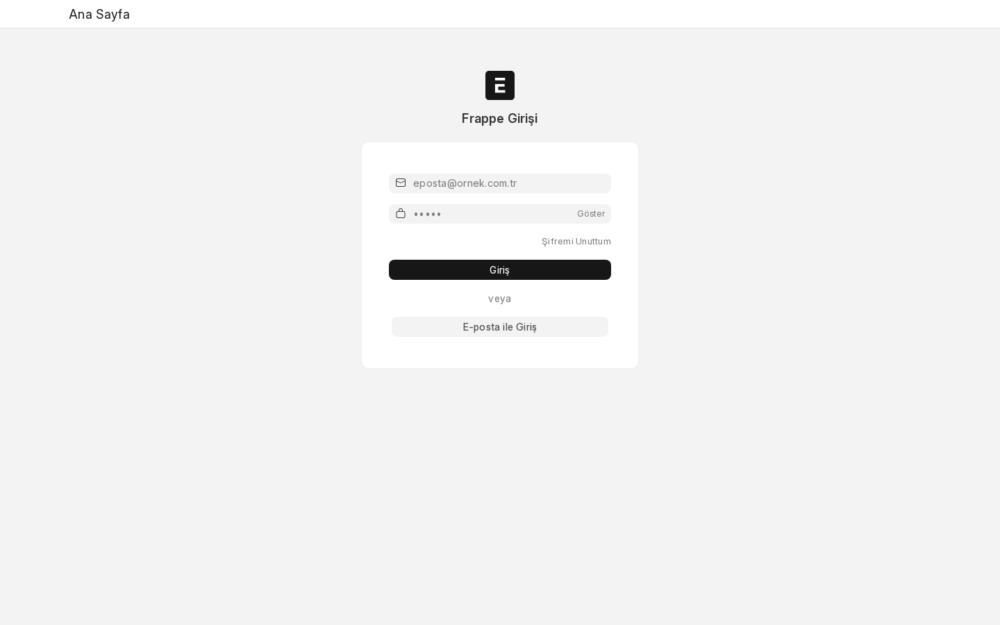
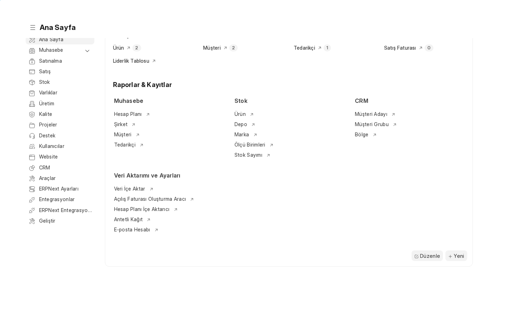
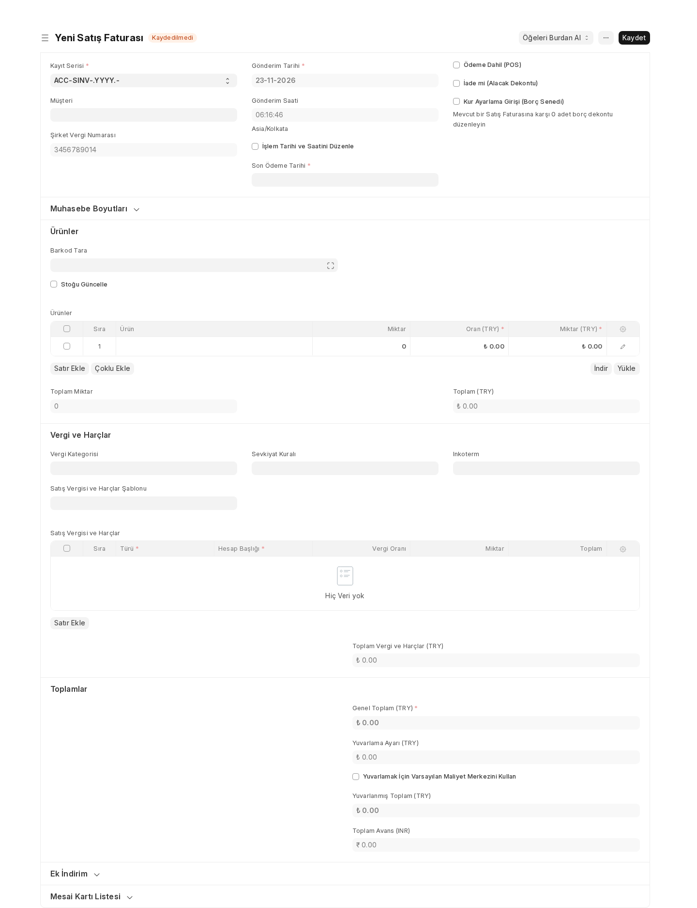
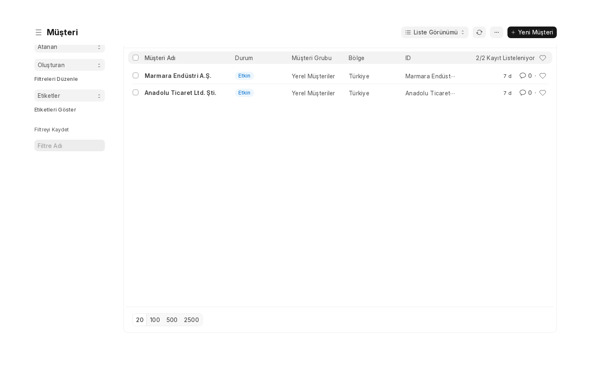
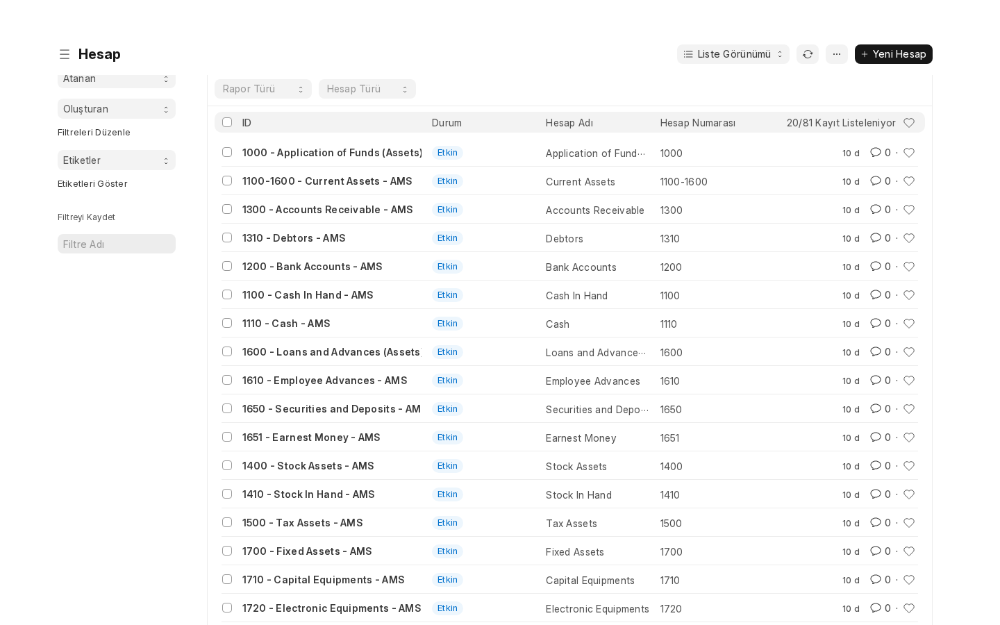
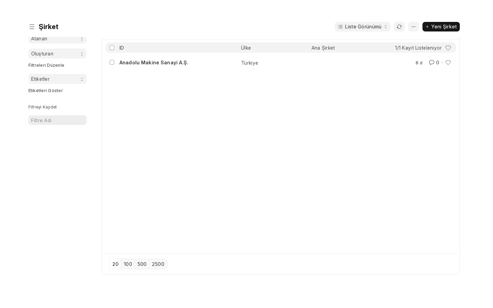

# Faz 1 — Kurulum ve Temel Yapılandırma (Tamamlandı)

Tarih: 2026-11-23 · Kapı: `make phase-gate` + site duman testleri **7/7 PASS**

## Amaç ve kapsam

Faz 1'in hedefi (bkz. [ROADMAP.md](../ROADMAP.md)): ERPNext'i Türkiye profiliyle
(Türkçe arayüz, TRY para birimi, Europe/Istanbul) ayağa kaldırmak, temel
yapılandırmayı yapmak ve **çalışan arayüzün kanıtını** ekran görüntüleriyle
deponuza gömmek. Çıkış kriteri KM-1: temel akışlar Türkçe arayüzde gezilebiliyor.

## Kurulan yığın (kullanıcı seviyesi — root gerekmez)

| Bileşen         | Sürüm    | Not                                                          |
| --------------- | -------- | ------------------------------------------------------------ |
| MariaDB         | 10.6.18  | resmi binary tarball, kullanıcı dizininde veri klasörü       |
| Redis           | 8.0.2    | Debian deb'inden çıkarılan binary; cache 13000 / queue 11000 |
| bench           | 5.31.1   | pip (frappe-bench)                                           |
| Frappe          | 15.127.1 | dal `version-15`, commit `0f31ab0` (bench init)              |
| ERPNext         | 15.126.0 | dal `version-15`, commit `a6f54f9` (bench get-app)           |
| erpnext_turkiye | 0.1.0    | bizim uygulamamız, siteye install-app edildi                 |

> Sürüm pinleri, Faz 2 raporunun tekrarlanabilirlik bölümüyle tutarlıdır
> (bkz. [FAZ2.md](FAZ2.md) §9). Kaynak kodlar repoda değil, bench çalışma
> alanında (`stack/frappe-bench/apps/`) tutulur; repo yalnızca bizim
> uygulamayı ve sürüm pinlerini taşır.

Sihirbazsız kurulumda karşılaşılan ve **kalıcı çözümü depoya işlenen** üç nokta:

1. `frappe.is_setup_complete()` System Settings yerine **Installed Application**
   kayıtlarını okur → `kurulum.kurulum_tamamlandi_isaretle()` fonksiyonu
   (`erpnext_turkiye/turkiye/kurulum.py`) bayrakları kapatır; masaüstü
   sihirbaza yönlendirmesi durur.
2. Ağaç doctype varsayılanları (Customer Group, Territory, Supplier Group,
   Item Group) ve UOM kayıtları kurulum sihirbazıyla oluşur; sihirbazsız
   kurulumda `kurulum.demo_verisi_olustur()` bunları idempotent şekilde
   tamamlar. TCKN/VKN doğrulama kancası Customer/Supplier kayıtlarında
   **canlı olarak tetiklendi** — demo verideki VKN'ler test paketindeki
   algoritma vektörleridir.
3. Warehouse Type "Transit" kaydı eksikse şirket kurulumu LinkValidationError
   verir → `kurulum.warehouse_turleri_tamamla()` tamamlar.

## Yapılandırılan site (turkiye.local)

- Dil: **tr** (sistem + Administrator), tarih biçimi dd.MM.yyyy
- Saat dilimi: **Europe/Istanbul**, ülke: **Turkey**
- Şirket: **Anadolu Makine Sanayi A.Ş.** — TRY, "Standard with Numbers"
  hesap planı (numerik kodlu; THP tam seti Faz 2'de), şirket VKN'si geçerli
  algoritma vektörü
- Demo ana veri: 2 müşteri, 1 tedarikçi, 2 hizmet kalemi (VKN doğrulaması
  geçerek oluşturuldu)

## Ekran görüntüleri (Türkçe arayüz)

| #   | Ekran                                                 | Kanıt                                                    |
| --- | ----------------------------------------------------- | -------------------------------------------------------- |
| 1   | Giriş ekranı                                          |           |
| 2   | Masaüstü ana sayfa (Türkçe modüller + demo sayaçları) |            |
| 3   | Yeni Satış Faturası formu (₺ sembollü)                |  |
| 4   | Müşteri listesi                                       |      |
| 5   | Hesap planı (numerik COA listesi)                     |            |
| 6   | Şirket sayfası                                        |                |

Duman testleri (`scripts/site_goruntu.mjs`): giriş Türkçe, API girişi,
masaüstü Türkçe modüller, fatura formu "Müşteri" alanı, müşteri listesi,
hesap listesi, şirket kaydı — **7/7 PASS**. Betik site-bağımlı olduğundan CI
kapılarına dahil değildir; faz çıkış kapısı ayrıca `make phase-gate` ile
(fixture tabanlı e2e) koşulur.

## Bilinen notlar (Faz 2'de ele alınır)

- Fatura formundaki saat dilimi ipucu ve "Toplam Avans (INR)" alanı ERPNext
  varsayılanlarından gelir; ülke-bazlı varsayılanlar Faz 2 yapılandırma
  paketinde temizlenir. → Avans alanı TRY olarak görüntüleniyor (Faz 2'de
  Administrator/site dili tr'ye sabitlendi ✓).
- Hesap planı hesap adları hâlâ İngilizce kaynak etiketlerle listelenir;
  Faz 2'de THP tam seti (Türkçe adlarla) yüklenecek. → **Yüklendi: 337 THP
  hesabı, çift kaynaklı doğrulama** (bkz. [FAZ2.md](FAZ2.md) §1 ✓).
- Turkish Delight uygulamasının entegrasyonu Faz 2 kurulum paketiyle
  değerlendirilecek (v15 uyumluluğu doğrulandıktan sonra). → Değerlendirildi:
  TCKN/VKN, THP ve KDV işlevleri kendi SAF çekirdeğimizle karşılandı;
  e-Fatura UBL-TR eşlemesinde referans alınacak (Faz 3, kod devralımı yok).

## Yeniden kurulum (tekrarlanabilirlik)

Yerel makinede aynı yığını kurmak için:

1. `bash scripts/bench_install.sh` — bench + frappe + erpnext + uygulama +
   site (native kurulum).
2. Site kurulumundan sonra sırasıyla:
   ```bash
   bench --site turkiye.local execute erpnext_turkiye.turkiye.kurulum.site_tr_ayarlari
   bench --site turkiye.local execute erpnext_turkiye.turkiye.kurulum.kurulum_tamamlandi_isaretle
   bench --site turkiye.local execute erpnext_turkiye.turkiye.kurulum.warehouse_turleri_tamamla
   bench --site turkiye.local execute erpnext_turkiye.turkiye.kurulum.sirket_olustur
   bench --site turkiye.local execute erpnext_turkiye.turkiye.kurulum.demo_verisi_olustur
   ```
3. `node scripts/site_goruntu.mjs` — ekran görüntüleri + duman testleri.
